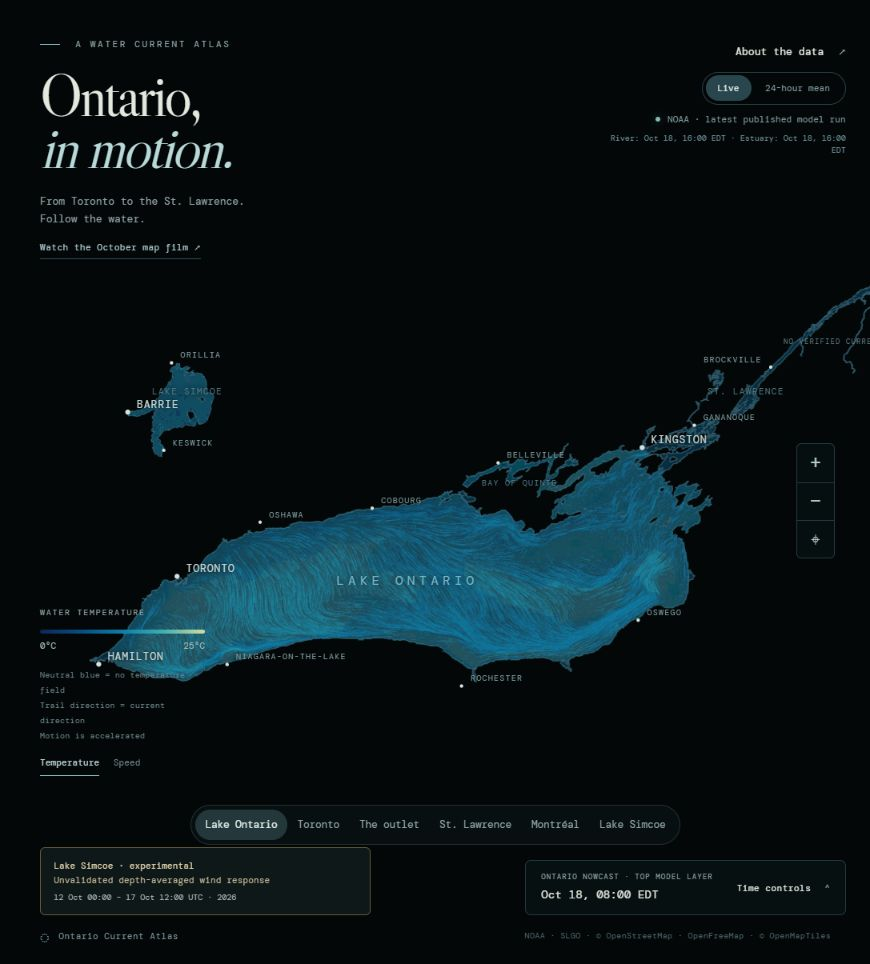

# Ontario Currents

An interactive atlas of modelled water currents from Lake Ontario into the St. Lawrence, with Lake Simcoe and the Montréal archipelago included in the shoreline geography. A companion MP4 presents a fixed October lake average and a labelled river estimate for sharing.

**[Explore the live atlas](https://khayoon.github.io/ontario-currents/)** · **[Watch the Lake Ontario close-up](https://khayoon.github.io/ontario-currents/media/lake-ontario-closeup.mp4?v=river-visible)** · **[Data and methods](docs/data-and-methods.txt)**

[](https://khayoon.github.io/ontario-currents/)

## What this project demonstrates

- **Scientific data visualization:** rasterizes NOAA's native unstructured mesh of 34,395 nodes and 64,453 triangles, retaining face-centred current vectors and interpolating node temperatures within triangles.
- **Interactive graphics:** Canvas particle animation, geographic pan and zoom, source-aware cursor readouts, temperature/speed layers and Lake Ontario forecast playback.
- **Numerical modelling:** separate experimental Simcoe wind-response and upper-river hydraulic solvers use public bathymetry and boundary records, with conservation and sensitivity checks. Their unvalidated depth averages are identified separately from retrieved current products.
- **Data engineering:** adapts multiple public model products with different layers, grids and valid times; preserves missing-data masks and reports the dates behind the display.
- **Static deployment with updating data:** a Node ingestion job publishes JSON for a static GitHub Pages frontend. The browser does not require a private proxy or a sign-in.
- **Resilience and provenance:** stored source fields remain available during upstream outages, with explicit refresh status and source times. Geography, model attribution and coverage limits accompany the visualization.

The retrieved current products are produced by NOAA, ECCC and DFO. This project implements their ingestion, visualization and publication; it does not claim authorship of those models. The separately identified Simcoe and upper-river experiments are implemented in this repository.

## Two views of the data

The **website** supports live-source exploration and sampled 24-hour vector means. Its Lake Ontario timeline and Canadian river/estuary products have independently reported valid times. Automated refreshes are scheduled hourly; execution depends on GitHub Actions and source availability. Read the dates shown in the interface.

The map fills the main view. The Ontario timeline, playback and refresh tools open through a compact **Time controls** disclosure.

The featured **MP4** is a silent 2560 × 1440 H.264 loop at 30 fps, lasting 20 seconds. Its close-up frames the whole of Lake Ontario and the upper river through Brockville, without insets, a timeline or controls. Bright trails trace the NOAA LOOFS surface vector mean for **12 October 2026 00:00 UTC–17 October 2026 12:00 UTC**, using 23 six-hourly samples. Particle motion is scaled for legibility; the logarithmic colour scale shows the magnitude of the mean vector, capped at 150+ cm/s. This is a sampled week-to-date mean, not an October climatology or a replay of changing conditions. The Kingston–Brockville reach now has a separately computed **ESTIMATES** layer, identified at the bottom of the film. It is an illustrative, steady depth-averaged hydraulic approximation using CHS bathymetry and mean water levels, calibrated to an IJC regulation-discharge scenario. It is unvalidated against local currents and does not resolve wind, vertical shear or inertial eddies. Its local speeds, particularly narrow-channel jets, are uncertain. See the [model, checks and limitations](docs/kingston-brockville-estimates.md).

The close-up uses finer current sampling to preserve narrow island passages, smaller bounded integration steps and denser trails in weak-flow areas. Slow nonzero vectors receive a bounded display-motion boost; colours retain the numerical speed scale. The [portable film renderer and frozen inputs](film/ontario-closeup/) describe the display choices.

The earlier [broader Ontario–St. Lawrence film](https://khayoon.github.io/ontario-currents/media/october-current-map.mp4) remains available. It includes Montréal and the estuary, plus a separately labelled experimental Simcoe inset. The live atlas retains that broader geographic scope.

**Lake Simcoe's experimental layer** is a fixed-date, unvalidated depth-averaged wind response, present in both website modes and labelled in the earlier broader film. It is not measured circulation or a surface-current forecast. Its physical assumptions, source data, solver and sensitivity checks are described in the [Simcoe model notes](docs/simcoe-model.md).

The main map uses brighter, longer flowing trails as well as the close-ups. The outer estuary is filled from a broader **DFO STLE500** archive mean for the same 12–17 October period; its fixed dates remain explicit on the website, and existing higher-resolution products retain priority. The tributary network and dashed watershed divide use official **LSRCA and Ontario** geography. These drainage lines carry no invented velocity field. See [Simcoe drainage sources](docs/simcoe-drainage.md) and [outer estuary sources](docs/outer-estuary.md).

## Run locally

Requires Node.js 22 or newer. No third-party npm packages are needed for the site.

```sh
npm run build
npm run check
npm run preview
```

Use the local URL printed by the preview server. To fetch new source fields before building, run the refresh script listed in `package.json`. The checked-in source fields allow a dated offline demonstration when network services are unavailable.

## Architecture

```text
NOAA LOOFS / ECCC OHPS / DFO STLE200
                 |
       Node source adapters and validation
                 |
      dated JSON fields, catalogue and means
                 |
     static build -> GitHub Pages -> Canvas atlas
```

- `src/` — browser application, native mesh, shoreline geometry and dated demonstration fields.
- `lib/` — source ingestion used by the refresh job.
- `scripts/` — refresh, static build, data checks and local preview.
- `.github/workflows/` — scheduled ingestion and GitHub Pages deployment.
- `media/` — the fixed October MP4.
- `model/simcoe/` and `model/upper-river/` — separate reproducible numerical experiments and frozen inputs; neither is required to run the static website.
- `docs/` — detailed source notes, attribution, limitations and further data-research requirements.

## Coverage and interpretation

Lake Ontario uses the LOOFS top sigma layer. The OHPS river field is depth-averaged; STLE200 is a surface estuary product. These layers are not physically interchangeable and remain identified in the interface and documentation.

Complete shoreline geography does **not** imply complete current coverage. The live atlas still has gaps in parts of Kingston–Brockville–Cornwall–Montréal, Montréal's northern channels and portions of the river outside the supplied model domains. The visible outer estuary now has a separately dated STLE500 supplement. Those waters remain visible. Simcoe now has an explicitly experimental wind response; its complete actual circulation remains unresolved. The featured film alone includes the separately labelled Kingston–Brockville estimate; it is not a live river forecast. Additional model archives and reconstructions are being investigated; the [research specification](docs/current-data-research.txt) records the exact missing regions and evidence required.

Opposing currents can cancel in a vector average. A weak mean vector does not establish that water was stationary throughout the period. Particle motion illustrates the supplied field and is not a reconstruction of observed water-parcel trajectories.

## Attribution

- [NOAA LOOFS](https://opendap.co-ops.nos.noaa.gov/thredds/catalog/NOAA/LOOFS/MODELS/catalog.html).
- [ECCC OHPS](https://eccc-msc.github.io/open-data/msc-data/nwp_ohps/readme_ohps_en/), with website access through [OGSL/SLGO ERDDAP](https://erddap.ogsl.ca/erddap/).
- [DFO POPS STLE200](https://dfo-ocean-navigator.github.io/Dataset-Descriptions/).
- Geography **© OpenStreetMap contributors · OpenFreeMap · © OpenMapTiles**. See [OpenStreetMap copyright](https://www.openstreetmap.org/copyright), [ODbL](https://opendatacommons.org/licenses/odbl/1-0/) and the [geography notes](docs/geography.md).

Source datasets retain their respective licences and attribution requirements. The visualization is intended for exploration and education, not navigation.
